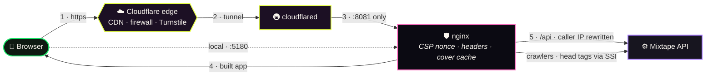

<div align="center">



<br>

**The site of Mixtape, your music diary: search the catalog, rate from 0 to 5 discs, stack your library,<br>dig through the record crate and share it all, in Portuguese, English and Spanish.**

<br>


<br>

### 🎧 Web · ⚙️ [API](https://github.com/PedroLucasLopes/mixtape-api-v1) · 🎨 [UI library](https://github.com/PedroLucasLopes/mixtape-lib-v1) · 🔐 [Auth library](https://github.com/PedroLucasLopes/mixtape-oauth-lib-v1)

📓 [Decision log](CLAUDE.md) <sub>(Portuguese)</sub> · ☁️ [The Cloudflare edge](cloudflare/README.md)

</div>


<div align="center">

## ⚡ Start in one command

</div>

```bash
docker compose up -d --build
```

> [!IMPORTANT]
> The site talks to the [Mixtape API](https://github.com/PedroLucasLopes/mixtape-api-v1), which runs in its
> own Compose project: bring it up first. Then copy `.env.example` to `.env`. The build installs the UI and
> auth libraries from GitHub Packages, so `NODE_AUTH_TOKEN` (a classic GitHub token with `read:packages`)
> must be in `.env` or in your terminal; Compose hands it to the build as a BuildKit secret, never as an
> image layer.

Open **http://localhost:5180**. 🎉

<br>

## 🗺️ From the browser to the API, in one diagram



<table>
<tr><td width="50%" valign="top">

**Two ideas hold it together**

1. **A page loads only what it uses.** Only Vuetify's core styles, SVG icons for the names in use, CSS split per page, languages on demand and global dialogs downloaded the first time they open.
2. **The edge and the headers are code.** A fresh CSP nonce on every request, the caller's IP rewritten by nginx, and the whole Cloudflare setup versioned and tested in [`cloudflare/`](cloudflare/README.md).

</td><td width="50%" valign="top">

**What that means in practice**

The home page went from **608 KB of CSS to 104 KB**, and the 403 KB icon font is gone. A script without the request's nonce never runs, and nobody can pick their own IP to dodge the API's rate limits.

</td></tr>
</table>


<div align="center">

# 🚀 Getting started

</div>

## 📋 Prerequisites

- **Docker with Compose v2**, and the [API](https://github.com/PedroLucasLopes/mixtape-api-v1) running on this machine. No Docker network is shared between the projects: nginx reaches the API through the port it publishes (`host.docker.internal`).
- To develop outside Docker, Node.js 22.12 or newer (24 LTS recommended).

### 🔐 The `.env`

| Variable | What it is |
|---|---|
| `WEB_PORT` | The site's port on this machine (default `5180`) |
| `MIXTAPE_API_UPSTREAM` | Where the container's nginx finds the API, e.g. `http://host.docker.internal:3001` |
| `MIXTAPE_PUBLIC_URL` | The site's public address, used in `robots.txt` |
| `MIXTAPE_DEV_API` | Where Vite finds the API during `npm run dev` |
| `VITE_CONTACT_EMAIL` | Contact shown in the privacy policy and terms (public: it ships to the browser) |
| `CLOUDFLARE_TUNNEL_TOKEN` | The tunnel's token, only with `COMPOSE_PROFILES=cloudflare` |
| `NODE_AUTH_TOKEN` | Classic GitHub token with `read:packages`, to install the libraries |

`.env` stays out of git and out of the image. npm does not read it: for `npm install` outside Docker, export `NODE_AUTH_TOKEN` in your terminal.

## 🐳 Bringing it up

```bash
docker compose up -d --build
```

| | Container | Role |
|:--:|---|---|
| 🛡️ | `web` | nginx (unprivileged) serving the build: CSP and security headers, `/api` proxy, head tags for crawlers, cover cache in the `nginx-cache` volume |
| 🚇 | `cloudflared` | The Cloudflare tunnel, only with `COMPOSE_PROFILES=cloudflare`: the machine opens no port, the tunnel dials out |

> [!WARNING]
> **Never publish nginx's port 8081.** It is the tunnel's entrance and trusts the `CF-Connecting-IP` header.
> Published, anyone could choose their own IP for the API's limits. Only port 8080 is published, as `WEB_PORT`.

## 🛠️ Everyday commands

<table>
<tr><th align="left">Goal</th><th align="left">Command</th></tr>
<tr><td>Develop with hot reload (port 5180, <code>/api</code> proxied to <code>MIXTAPE_DEV_API</code>)</td><td><code>npm ci</code>, then <code>npm run dev</code></td></tr>
<tr><td>Build exactly as the Dockerfile does (types, translations, icons, Vite)</td><td><code>npm run build</code></td></tr>
<tr><td>See what weighs in each chunk</td><td><code>npm run analyze</code></td></tr>
<tr><td>Regenerate the API types from OpenAPI</td><td><code>npm run generate:api</code></td></tr>
<tr><td>Register a new <code>mdi-*</code> icon</td><td><code>npm run sync:icons</code></td></tr>
<tr><td>Preview, apply and test the Cloudflare edge</td><td><code>npm run edge:plan</code>, <code>npm run edge:apply</code>, <code>npm run test:edge</code></td></tr>
<tr><td>Bring the tunnel up with the site</td><td><code>COMPOSE_PROFILES=cloudflare docker compose up -d</code></td></tr>
</table>


<div align="center">

# 📡 Using

</div>

## 🗂️ What is on the site

| | Screen | Path |
|:--:|---|---|
| 🏠 | Home: albums and songs trending on Mixtape, latest reviews, the month's ranking, Awards and community playlists | `/` |
| 🔎 | Search: albums, tracks, artists and people, with a record-crate view | `/search` |
| ⭐ | Rate: suggestions for you, trending worldwide and on Mixtape | `/search?rate=1` |
| 💿 | Album, track and artist pages, with ratings, listeners and where to listen | `/albums/:id`, `/tracks/:id`, `/artists/:id` |
| 📈 | Charts: week, month, year and all time | `/charts` |
| 👤 | Profile: favorites, Discover, listen later, recent reviews, badges | `/u/:username` |
| 📚 | Library: grid with album stacks, list or record crate | `/u/:username/library` |
| 🎶 | Playlists of albums, tracks, artists and reviews | `/playlists` |
| 👯 | Groups, crew reviews and invites | `/groups`, `/group-reviews/:id` |
| 🏆 | Rankings, monthly Awards and how it all works | `/rankings`, `/awards`, `/how-it-works` |
| ⚙️ | Settings, account and security | `/settings`, `/settings/account` |
| 🔐 | Sign in, sign up, new password and account deletion by e-mailed link | `/login`, `/register`, `/forgot-password`, `/reset-password`, `/delete-account` |

## 🔐 Sessions, in short

- **Login happens on Mixtape's own screen**; the API checks the password with Auth0 and opens its own session.
- The refresh token lives in an `HttpOnly`, `SameSite=Strict` cookie scoped to `/api/v1/auth`; the access token lives **only in memory**. `localStorage` keeps just a hint that a session exists, never a token.
- **Passwords change only through the e-mailed link.** The token travels in the URL fragment, leaves the address bar as soon as the page opens, and is checked before the form appears.
- A [Turnstile](https://www.cloudflare.com/products/turnstile/) check guards sign-in, sign-up and "forgot password", invisibly unless Cloudflare asks for a click.
- Tabs keep sign-in and sign-out in sync through a `BroadcastChannel`.

## 🧪 Running the tests

```bash
npm test             # unit: forms, password rules, navigation, periods, HTTP client
npm run test:e2e     # end to end with Playwright in Chrome (needs the API and the site running)
```

<div align="center">

**72 end-to-end tests** with real typing and a real mouse · **31 unit tests** · desktop and mobile

</div>

<table>
<tr><th>Layer</th><th>Runs against</th><th>Answers</th></tr>
<tr>
  <td><b>Unit</b><br><sub><code>npm test</code></sub></td>
  <td>memory only (Vitest)</td>
  <td>Do the password rules match the API's? Does the HTTP client renew the session and translate every error code?</td>
</tr>
<tr>
  <td><b>End to end</b><br><sub><code>npm run test:e2e</code></sub></td>
  <td>the running site and API, with a fresh <code>e2e_*</code> account per run</td>
  <td>Login, sign-up, password reset and account deletion through the test inbox, search, the record crate with mouse and keyboard, library stacks, favorites, people search and profile privacy</td>
</tr>
<tr>
  <td><b>Checks</b><br><sub>in the build</sub></td>
  <td>the source</td>
  <td>Every interactive element has a <code>data-testid</code>, the three languages have the same 1,358 keys, every <code>mdi-*</code> icon is registered</td>
</tr>
</table>

```bash
npm run lint
npm run check:testids
npm run check:locales
npm run check:icons
```

**Continuous integration** (`.github/workflows/ci.yml`) audits the dependencies and runs lint, tests, the build and the Docker image on every pull request and push to `main`. **Git hooks (Husky):** `pre-commit` runs only the checks the staged files need, `commit-msg` enforces Conventional Commits, and `pre-push` runs the type check and the unit tests.


<div align="center">

# 🏗️ Understanding

</div>

## 📂 How the code is organized

```
src/
│
├── 📌 constants/      everything fixed: API routes, navigation, SEO, validation, filters, data sources
├── 🔌 plugins/        i18n (languages on demand), Vuetify (core plus SVG icons), the generated icon set
├── 🧭 router/         lazy routes, loading, session guards
├── 📡 services/       HTTP client (session renewal, translated errors) and the Mixtape API
├── 🗃️ stores/         session, preferences, announcements, consent and the global dialogs
├── 🪝 composables/    async data, pagination, SEO, labels, catalog cards
├── 🧱 layouts/        AppLayout (global dialogs on demand) and AuthLayout
├── 📄 pages/          one per route
├── 🧩 components/     application pieces; generic ones live in the UI library
├── 🗣️ locales/        pt-BR (reference), en, es
├── 🏷️ types/          types generated from the API's OpenAPI, and derived ones
└── 🔧 utils/          forms, items, navigation, periods, each with tests
```

Next to `src/`: `nginx/` (two ports, the site, caller IP, security headers), `cloudflare/` (the edge as code), `e2e/` (Playwright) and `scripts/` (translation, icon, test-id and API-type tooling).

## ⚡ Performance: a page loads only what it uses

Measured on the home page, in the production container, before and after the switch:

| | Before | After |
|---|---|---|
| CSS | 608 KB in one file, 8,412 rules | **104 KB**, split per page, 1,018 rules |
| Icon font | 403 KB of woff2 | **none** (SVG, only the icons in use) |
| Decoded JavaScript | 722 KB | **608 KB** |
| Animated `filter` / `will-change` | blurred blobs, drop shadows / 20 | **0 / 5** |

| Rule | How |
|---|---|
| **Vuetify core only** | `vuetify/styles/core`; the few utilities Vuetify components emit on their own ship in the UI library's base CSS |
| **SVG icons, only the used ones** | `sync:icons` generates the `mdi-*` names found in the code; the name stays `mdi-album` |
| **CSS per component** | the UI library ships one file per module with its own CSS; unused components leave the bundle |
| **Languages on demand** | pt-BR in the bundle; English and Spanish are chunks loaded before mounting or switching |
| **Global dialogs on first open** | `defineAsyncComponent` plus a latch: the chunk downloads only when a dialog first opens |
| **First-frame fonts preloaded** | Bricolage Grotesque and Figtree, because the hero title is the largest contentful paint |

## 🛡️ Headers, CSP and crawlers

- **A nonce per request.** Vite writes a placeholder into every `<script>` and `<link>`; nginx swaps it for the request id and sends the same value in `Content-Security-Policy` (`script-src 'nonce-…' 'strict-dynamic'`). That is why HTML is never cached, not even by Cloudflare.
- **Security headers:** `nosniff`, `X-Frame-Options: DENY`, `Referrer-Policy`, `Permissions-Policy`, COOP, and HSTS only behind https.
- **Crawlers** (search engines and link previews on WhatsApp, Telegram, X, Facebook) get each page's `<head>` rendered by the API and included by nginx through SSI; in the browser, `@unhead/vue` takes over.
- **The caller's IP** is rewritten by nginx, never appended to what the browser sent, and the API trusts exactly one proxy hop.

## 🧭 Technical decisions

The long version, with the traps already paid for, is in the [decision log](CLAUDE.md) (Portuguese).

<details open>
<summary><b>Summary of the decisions</b></summary>

<br>

| Decision | Rejected alternative | Why |
|---|---|---|
| **Components come from the UI library as an npm package** | Importing `../ui/src` | Each project builds and ships on its own; the library is versioned like any dependency |
| **Access token only in memory, refresh token in an `HttpOnly` cookie** | Tokens in `localStorage` | Injected script cannot steal a long-lived session |
| **Nonce-based CSP with `strict-dynamic`** | `unsafe-inline` or host allowlists | Only scripts this page loaded can run |
| **Head tags for crawlers rendered by the API** | Server-side rendering the whole app | Link previews and search work while the app stays a static build |
| **Every listener count says "on ListenBrainz"** | A bare number | The source's community is smaller than the world's; an unlabeled number looked wrong |
| **Edge as code on Cloudflare's Free plan** | Clicking through the dashboard | Reviewable, repeatable, and tested without touching the account |

</details>

## ⚠️ Known limitations

<details>
<summary><b>What is still on the table</b></summary>

<br>

1. **No public domain yet.** The Cloudflare edge is ready as code and goes live with the domain; until then the site runs on `localhost` with Turnstile's test keys.
2. **The end-to-end suite needs the whole stack running** (API, site and the test inbox); it is not part of continuous integration yet.
3. **The lockout after repeated wrong passwords is tested by the separate security suite**, not here: the login limit per IP leaves no room to test both in one run.

</details>


<div align="center">

<br>

**Data shown:** [MusicBrainz](https://musicbrainz.org) (CC0) · [Cover Art Archive](https://coverartarchive.org) · [Wikimedia Commons](https://commons.wikimedia.org) · [ListenBrainz](https://listenbrainz.org)

**Type and icons:** [Bricolage Grotesque](https://fonts.google.com/specimen/Bricolage+Grotesque) and [Figtree](https://fonts.google.com/specimen/Figtree) (OFL, self-hosted) · [Material Design Icons](https://pictogrammers.com/library/mdi/) (Apache 2.0) · [Font Awesome Free](https://fontawesome.com) (CC BY 4.0, the burger menu)

<br>

🎧 Web · ⚙️ [API](https://github.com/PedroLucasLopes/mixtape-api-v1) · 🎨 [UI library](https://github.com/PedroLucasLopes/mixtape-lib-v1) · 🔐 [Auth library](https://github.com/PedroLucasLopes/mixtape-oauth-lib-v1)

<sub>Proprietary, all rights reserved · Mixtape, your music diary</sub>

</div>
